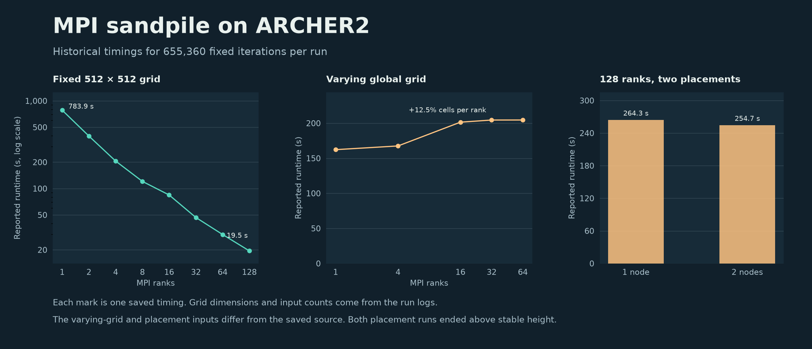

# MPI Sandpile Study

In my MSc Message-Passing Programming coursework at the University of
Edinburgh, I implemented a two-dimensional MPI decomposition for a sandpile
simulation and ran it on ARCHER2. This case study audits the saved cluster
measurements and checks the archived solver against a separate serial model.

Each unstable cell topples once per iteration and sends one grain to each
orthogonal neighbour. Grains wrap around the columns and escape through the
top and bottom rows. The solver partitions the grid into equal blocks, overlaps
nonblocking halo exchange with interior work, and assembles the final grid on
rank zero.



## What the ARCHER2 records show

| Series | Recorded result | Evidence limit |
| --- | --- | --- |
| Fixed grid | 783.90 s at 1 rank and 19.48 s at 128 ranks on a 512 × 512 grid, a 40.25× runtime ratio | One saved timing at each rank count |
| Varying grid | 162.29–204.59 s across 1–64 ranks | The 32-rank run used 12.5% more cells per rank. All five runs used a different initial pile from the saved source. |
| Node placement | 264.34 s on one node and 254.66 s on two at 128 ranks | Both runs used a different initial pile from the saved source and ended above the stable height. |

The run logs describe **655,360 fixed iterations** for every case. The
reported runtimes measure those iterations. The archived job scripts and
saved source match the submitted ZIP, but the exact binary for each historical
run is unknown. See the [record audit](docs/method.md) and the
[15 timing and workload records](data/archer2-records.csv).

## Exact grid check on a local machine

A temporary build of the saved solver matched an independent serial reference
**cell for cell in 12 cases**, using one, two, four and eight MPI ranks. The
tests cover centre and corner piles, a periodic edge, loss through the open
boundary and a 2 × 2 grid with one cell per rank. The reference independently
counted escaped grains, and all twelve totals balanced.

The build changed the iteration count and replaced the image writer with an
integer grid dump for these checks. The [local results](data/local-full-grid.json)
record the environment, case sizes, rank grids and mismatched-cell counts.
The coursework archive retains the solver, images and raw logs.

## Recreate the timing figure

```sh
python3 -m venv .venv
. .venv/bin/activate
python -m pip install -r requirements.txt
python scripts/plot_results.py
```

The script regenerates `figures/archer2-timings.png` from the included CSV.
The [method](docs/method.md) describes the inputs needed to repeat the
separate local solver check with access to the original submission.
